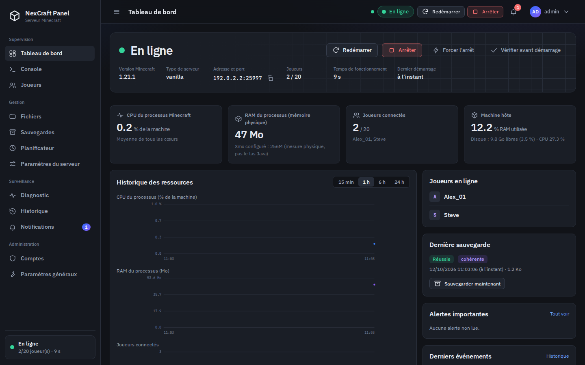
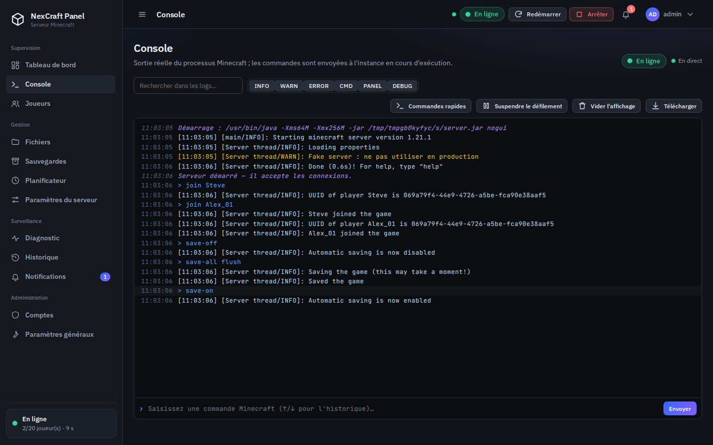
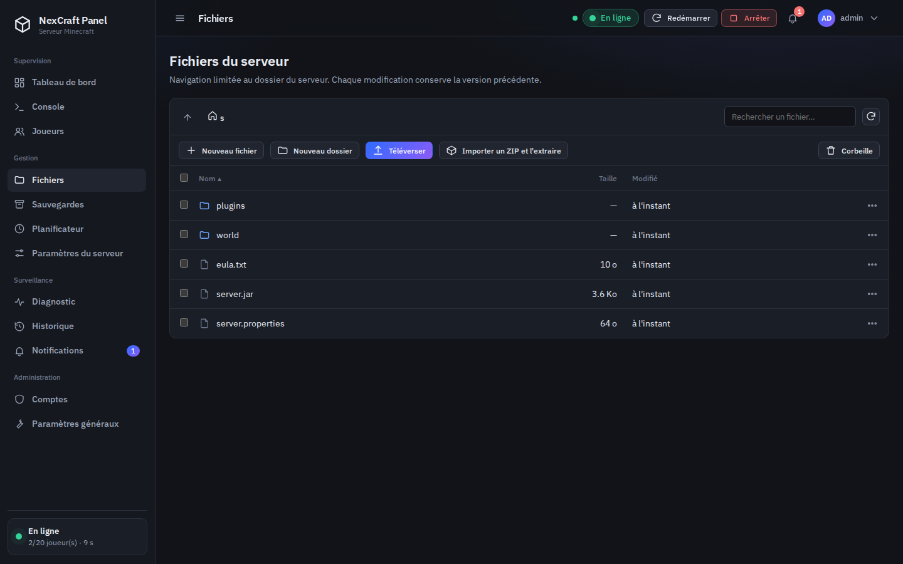
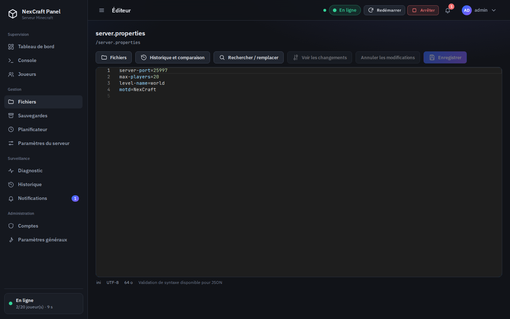
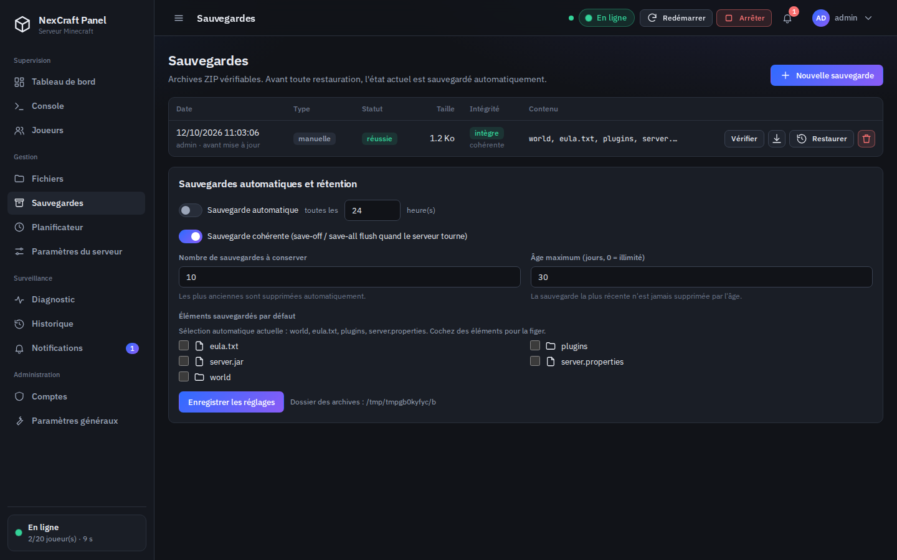
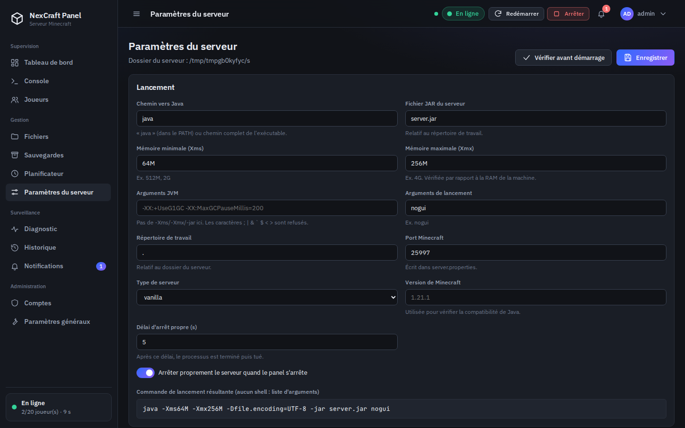

# NexCraft Panel

Panneau de contrôle **web** pour gérer **un serveur Minecraft Java** depuis un navigateur — démarrage/arrêt, console en direct,
gestionnaire de fichiers avec éditeur, joueurs, sauvegardes, planification, diagnostic — sans jamais ouvrir de terminal sur la machine hôte.
Inspiré de Crafty Controller, optimisé pour **un seul serveur à la fois**.

> Backend Python 3.11+ (FastAPI + Uvicorn), SQLite (SQLAlchemy), WebSockets, interface HTML/CSS/JavaScript sans étape de compilation.
> Tout est embarqué (éditeur Monaco, polices) : **le panel fonctionne hors ligne** une fois installé.

## Sommaire

1. [Fonctionnalités](#fonctionnalités) · 2. [Captures d'écran](#captures-décran) · 3. [Prérequis](#prérequis)
4. [Installation Windows](#installation-windows) · 5. [Installation Linux](#installation-linux) · 6. [Première connexion](#première-connexion)
7. [Configuration de Java](#configuration-de-java) · 8. [Installation du serveur Minecraft](#installation-du-serveur-minecraft)
9. [Gestion des fichiers](#gestion-des-fichiers) · 10. [Sauvegardes et restaurations](#sauvegardes-et-restaurations)
11. [Accès distant sécurisé](#accès-distant-sécurisé) · 12. [Configuration](#configuration) · 13. [Comptes et permissions](#comptes-et-permissions)
14. [Dépannage](#dépannage) · 15. [Emplacement des logs](#emplacement-des-logs) · 16. [Mise à jour](#procédure-de-mise-à-jour)
17. [Désinstallation](#procédure-de-désinstallation) · 18. [Sécurité](#sécurité) · 19. [Architecture](#architecture) · 20. [Tests](#tests) · 21. [Limites connues](#limites-connues)

## Fonctionnalités

**Contrôle du serveur** — démarrer, arrêter proprement (commande `stop`, puis terminaison, puis arrêt forcé avec confirmation), redémarrer, envoyer
une commande ; configuration de Java, du JAR, de la mémoire, des arguments JVM, du port et des variables d'environnement autorisées (commande
construite comme **liste d'arguments, sans shell**, et validée avant lancement). Assistant d'installation de versions officielles
(Vanilla, Paper, Purpur, Fabric) avec vérification de somme de contrôle.

**Démarrage intelligent** — rapport préalable : Java présent et compatible (version déduite du JAR et de la version Minecraft), JAR lisible, RAM
disponible, permissions, port libre, processus orphelin, EULA, espace disque — avec la solution proposée pour chaque problème.

**Console en direct** — la sortie réelle du processus (WebSocket), couleurs par niveau, horodatage, recherche, filtres, historique des commandes
(↑/↓), pause du défilement, vidage de l'affichage sans toucher aux logs sur disque, téléchargement, reconnexion automatique sans perte de lignes,
limitation de fréquence, confirmation des commandes sensibles (`stop`, `op`, `ban`, `reload`…).

**Fichiers** — explorateur confiné au dossier du serveur, téléversement (glisser-déposer, progression), téléchargement (ZIP multi-sélection),
création, renommage, copie, déplacement, recherche, tri, import/extraction de ZIP protégé, **corbeille restaurable**, **historique des versions**
de chaque fichier modifié, comparateur de configurations, détection des modifications concurrentes.
**Éditeur Monaco** (coloration, numéros de ligne, recherche/remplacement, Ctrl+S, avertissement avant de quitter, erreurs de syntaxe JSON).

**Joueurs** — connectés (lus dans la sortie réelle), historique avec UUID, liste blanche, opérateurs, bannis, IP bannies (rôles autorisés).

**Sauvegardes** — manuelles ou automatiques, **cohérentes** (`save-off` / `save-all flush` / `save-on` si le serveur tourne), vérification d'intégrité
(SHA-256 + test ZIP), téléchargement, rétention configurable, restauration avec **sauvegarde de sécurité préalable**, remplacement atomique et retour arrière.

**Innovations** — diagnostic par règles (sans IA externe par défaut) · historique des actions · planificateur (redémarrage, sauvegarde, commande,
notification, vérification) sans double exécution après redémarrage du panel · gestion des crashs (rapport, code de sortie, redémarrage automatique à
délai progressif) · mode maintenance · indicateur de santé **expliqué** · centre de notifications · comparateur de configurations · mode économie.

## Captures d'écran

Captures réelles du panel en fonctionnement (serveur de test).

| | |
|---|---|
|  |  |
|  |  |
|  |  |

## Prérequis

* **Python 3.11 ou supérieur** (avec `venv` et `pip`).
* **Java** (JDK ou JRE) pour exécuter le serveur Minecraft — [voir la section Java](#configuration-de-java). Il n'est pas fourni avec le panel.
* Windows 10/11 ou Linux (macOS devrait fonctionner mais n'est pas supporté officiellement). Un navigateur moderne.
* Une connexion Internet **uniquement** pour l'installation des dépendances Python et, si vous les utilisez, pour télécharger des versions de serveur.

## Installation Windows

1. Téléchargez `NexCraft-Panel.zip` et **extrayez-le** (clic droit → *Extraire tout…*) dans un dossier dont le chemin est simple, par exemple `C:\NexCraft-Panel`.
2. Double-cliquez sur **`install.bat`**. Le script vérifie Python 3.11+, crée un environnement virtuel `.venv`, installe les dépendances et prépare le fichier `.env`.
   Si Python est absent, installez-le depuis <https://www.python.org/downloads/> en cochant **« Add python.exe to PATH »**.
3. Double-cliquez sur **`start.bat`**. Une fenêtre affiche l'adresse du panel (par défaut <http://localhost:8080>).
4. Ouvrez cette adresse dans votre navigateur et [créez votre compte administrateur](#première-connexion).

Aucun script ne désactive l'antivirus, le pare-feu ou une protection du système. Windows peut vous demander d'autoriser Python/Java sur le réseau
privé : c'est nécessaire uniquement pour que **les joueurs** se connectent au serveur Minecraft (port 25565), pas pour le panel.

## Installation Linux

```bash
unzip NexCraft-Panel.zip
cd NexCraft-Panel
./install.sh     # vérifie Python 3.11+, crée .venv, installe les dépendances, prépare .env
./start.sh       # lance le panel ; ouvrez l'adresse affichée (http://localhost:8080)
```

Sur Debian/Ubuntu, il peut falloir `sudo apt install python3 python3-venv python3-pip`. Pour lancer le panel en service (systemd), créez une unité qui exécute
`/chemin/NexCraft-Panel/start.sh` avec un utilisateur **non privilégié** (jamais root).

## Première connexion

1. Au premier lancement, la page **« Configuration initiale »** s'affiche. Choisissez un nom d'utilisateur et un mot de passe
   (10 caractères minimum, au moins 3 types parmi minuscules, majuscules, chiffres, symboles).
2. Cette création n'est possible **que depuis la machine locale** (`localhost`). Il n'existe **aucun compte ni mot de passe par défaut**.
3. Ensuite, le panel affiche la page de connexion. Les comptes se gèrent dans **Comptes et permissions**.

**Mot de passe administrateur perdu ?** Sur la machine hôte (panel arrêté ou non) :

```bash
.venv/bin/python -m app.manage reset-password NOM_DU_COMPTE        # Linux
.venv\Scripts\python.exe -m app.manage reset-password NOM_DU_COMPTE  # Windows
# options : --activate (réactive un compte désactivé), --make-admin ; « list-users » liste les comptes
```

## Configuration de Java

Le panel exécute `java` (cherché dans le `PATH`) ou le chemin complet que vous indiquez dans **Paramètres du serveur → Chemin vers Java**
(ex. `C:\Program Files\Eclipse Adoptium\jdk-21\bin\java.exe` ou `/usr/lib/jvm/java-21-openjdk-amd64/bin/java`). Le fichier doit s'appeler `java`/`java.exe`.

Versions de Java usuelles : **Java 21** pour Minecraft 1.20.5 et plus récent, **Java 17** pour 1.18 à 1.20.4, Java 16+ pour 1.17, Java 8 pour les versions plus anciennes.
Pour les versions de Minecraft récentes dont le numéro ne suit plus le format `1.x`, le panel déduit la version de Java requise **de la classe principale du JAR** ;
en cas d'incertitude, le rapport « Vérifier avant démarrage » affiche un avertissement plutôt qu'une valeur inventée.
Une distribution libre comme Eclipse Temurin (<https://adoptium.net>) convient.

**Mémoire** : `Xms` (minimale) et `Xmx` (maximale), ex. `1G` / `4G`. Le panel refuse `Xms > Xmx` ou une valeur supérieure à la RAM de la machine, et avertit si elle dépasse la RAM actuellement libre.
Les options `-Xms/-Xmx/-jar/-cp` ne se saisissent pas dans « Arguments JVM » (champs dédiés), et les caractères `; | & ` $ < >` y sont refusés.

## Installation du serveur Minecraft

**Option A — assistant** : *Paramètres du serveur → Installer ou changer de version* : choisissez le type (Vanilla, Paper, Purpur, Fabric) puis la version.
Le fichier est téléchargé depuis la **source officielle en HTTPS** (hôtes autorisés uniquement), vérifié par somme de contrôle (SHA-1/SHA-256/MD5 selon la source) puis installé ;
tout fichier non vérifiable (Fabric ne publie pas de somme de contrôle) exige votre **confirmation explicite**. Le panel n'exécute jamais un fichier non vérifié silencieusement.
Pour Paper, renseignez `NEXCRAFT_CONTACT` (URL ou e-mail) dans `.env` : PaperMC demande un contact dans le `User-Agent`.

**Option B — import manuel** (Forge, NeoForge, Spigot, autre) : téléversez le JAR du serveur dans **Fichiers**, puis indiquez son nom et le type dans *Paramètres du serveur*.

**CLUF Mojang (EULA)** : Minecraft refuse de démarrer sans `eula.txt` contenant `eula=true`. Le rapport « Vérifier avant démarrage » propose **« Lire et accepter le CLUF »** :
vous acceptez explicitement <https://aka.ms/MinecraftEULA> ; le panel ne l'accepte jamais à votre place.

Ensuite : **Tableau de bord → Démarrer**. Le port du jeu (25565 par défaut) est écrit dans `server.properties` ; c'est ce port-là — pas celui du panel — que les joueurs utilisent.

## Gestion des fichiers

* Le gestionnaire est **limité au dossier du serveur** (`./server` par défaut). `..`, chemins absolus, lettres de lecteur et liens symboliques pointant à l'extérieur sont refusés.
* **Suppression** : les éléments vont à la **corbeille** (conservation configurable, 7 jours par défaut) et se restaurent depuis le bouton *Corbeille*.
* **Historique** : chaque enregistrement/écrasement/renommage/suppression d'un fichier de moins de 5 Mo conserve la version précédente (20 versions par fichier par défaut).
  Dans l'éditeur : *Historique et comparaison* → comparer à la version actuelle, restaurer, ou comparer avec un autre fichier.
* **Modifications concurrentes** : si le fichier change sur le disque pendant que vous l'éditez, l'enregistrement est refusé et un comparateur vous laisse choisir.
* **Fichiers binaires** (JAR, mondes, images…) ne s'ouvrent pas comme du texte ; les fichiers texte non UTF-8 sont refusés plutôt que corrompus ; limite d'édition 2 Mo.
* **ZIP** : l'extraction refuse les chemins malveillants, les liens symboliques et les archives disproportionnées (« zip bombs »).
* Téléversement limité à `NEXCRAFT_MAX_UPLOAD_MB` (512 Mo par défaut). Le mode maintenance peut bloquer les écritures ; elles sont aussi bloquées pendant une restauration.

## Sauvegardes et restaurations

* **Contenu par défaut** : mondes détectés (`level-name`, `_nether`, `_the_end`), fichiers de configuration à la racine (`.properties`, `.json`, `.yml`, `.toml`, `.txt`…), `plugins/`, `config/`… ;
  les JAR du serveur et les logs sont exclus. Vous pouvez figer une sélection personnalisée.
* **Cohérence** : serveur en ligne → `save-off`, `save-all flush`, attente de la confirmation du serveur, archivage, puis `save-on` (toujours rétabli).
  Une sauvegarde dont la cohérence n'a pas pu être confirmée est marquée comme telle.
* **Archives** : `backups/backup-AAAAMMJJ-HHMMSS-<type>.zip` avec manifeste, empreinte SHA-256, test d'intégrité à la création et à la demande.
* **Automatique** : activez-la dans *Sauvegardes* (toutes les N heures) ; rétention : nombre à conserver et âge maximum (la plus récente n'est jamais supprimée par l'âge).
* **Restauration** : confirmation obligatoire ; le serveur doit être arrêté (le panel peut l'arrêter proprement pour vous) ; **une sauvegarde de sécurité de l'état actuel est créée avant** ;
  l'extraction se fait dans un dossier temporaire puis remplace les éléments ; en cas d'erreur, l'état d'origine est remis en place (et conservé s'il ne peut pas l'être).

## Accès distant sécurisé

Par défaut le panel écoute **uniquement sur `127.0.0.1`** : il n'est pas joignable depuis Internet ni depuis votre réseau. **Ne le publiez pas en HTTP clair.**
Deux méthodes pour un accès distant, toutes deux avec HTTPS :

**1. Reverse proxy (recommandé)** — gardez `NEXCRAFT_HOST=127.0.0.1` et placez Caddy/Nginx devant. Exemple `.env` :

```ini
NEXCRAFT_HOST=127.0.0.1
NEXCRAFT_ALLOWED_HOSTS=panel.exemple.fr
NEXCRAFT_PROXY_HEADERS=true
NEXCRAFT_SECURE_COOKIES=true
```

Caddy (HTTPS automatique) :

```
panel.exemple.fr {
    reverse_proxy 127.0.0.1:8080
}
```

Nginx (les en-têtes `Upgrade`/`Connection` sont indispensables aux WebSockets, `Host` à la protection d'origine) :

```nginx
server {
    listen 443 ssl;
    server_name panel.exemple.fr;
    ssl_certificate     /chemin/fullchain.pem;
    ssl_certificate_key /chemin/privkey.pem;
    client_max_body_size 600m;
    location / {
        proxy_pass http://127.0.0.1:8080;
        proxy_http_version 1.1;
        proxy_set_header Host $host;
        proxy_set_header X-Forwarded-For $remote_addr;
        proxy_set_header X-Forwarded-Proto $scheme;
        proxy_set_header Upgrade $http_upgrade;
        proxy_set_header Connection "upgrade";
        proxy_read_timeout 3600s;
    }
}
```

**2. HTTPS direct** — `NEXCRAFT_SSL_CERTFILE` et `NEXCRAFT_SSL_KEYFILE` (fichiers PEM), `NEXCRAFT_HOST=0.0.0.0`, `NEXCRAFT_ALLOWED_HOSTS` avec votre nom d'hôte.

Bonnes pratiques : **créez le compte administrateur en local avant** d'exposer le panel (la création initiale est refusée à travers un proxy) ; n'ouvrez au pare-feu que le port HTTPS du proxy
(**jamais** le port interne 8080) ; le port du jeu (25565) est un tout autre sujet ; utilisez des mots de passe robustes ; consultez régulièrement *Historique → Connexions*.
Sans HTTPS, ne définissez pas `NEXCRAFT_SECURE_COOKIES=true` (le navigateur refuserait le cookie de session).

## Configuration

Fichier `.env` (copie de `.env.example`) ou variables d'environnement `NEXCRAFT_*`. Les réglages d'usage (sauvegardes, seuils, maintenance…) se modifient dans l'interface.

| Variable | Défaut | Rôle |
|---|---|---|
| `NEXCRAFT_HOST` | `127.0.0.1` | Adresse d'écoute (loopback = machine locale uniquement) |
| `NEXCRAFT_PORT` | `8080` | Port du panel |
| `NEXCRAFT_ALLOWED_HOSTS` | `localhost,127.0.0.1,[::1]` | Noms d'hôte acceptés (protection DNS rebinding) |
| `NEXCRAFT_ALLOW_REMOTE_SETUP` | `false` | Autorise la création du 1er administrateur à distance |
| `NEXCRAFT_SSL_CERTFILE` / `NEXCRAFT_SSL_KEYFILE` | vide | HTTPS direct (PEM) |
| `NEXCRAFT_PROXY_HEADERS` / `NEXCRAFT_FORWARDED_ALLOW_IPS` | `false` / `127.0.0.1` | Faire confiance aux en-têtes `X-Forwarded-*` d'un reverse proxy |
| `NEXCRAFT_DATA_DIR` | `./data` | Base SQLite, historique des fichiers, corbeille, rapports de crash |
| `NEXCRAFT_SERVER_DIR` | `./server` | Dossier du serveur Minecraft (racine du gestionnaire de fichiers) |
| `NEXCRAFT_BACKUP_DIR` | `./backups` | Archives de sauvegarde |
| `NEXCRAFT_LOG_DIR` | `./logs` | Journaux du panel |
| `NEXCRAFT_SECURE_COOKIES` | `auto` | `auto` (selon HTTPS), `true` ou `false` |
| `NEXCRAFT_SESSION_HOURS` / `NEXCRAFT_IDLE_MINUTES` | `12` / `120` | Durée maximale de session / inactivité tolérée |
| `NEXCRAFT_LOGIN_MAX_FAILURES` / `NEXCRAFT_LOGIN_WINDOW_MINUTES` | `5` / `15` | Verrouillage après échecs de connexion |
| `NEXCRAFT_MAX_UPLOAD_MB` | `512` | Taille maximale d'un téléversement |
| `NEXCRAFT_MAX_EXTRACT_MB` | `4096` | Taille décompressée maximale (extraction ZIP, archives) |
| `NEXCRAFT_MAX_EDIT_KB` | `2048` | Taille maximale d'un fichier ouvert dans l'éditeur |
| `NEXCRAFT_ENV_ALLOWLIST` | `TZ,LANG,LC_ALL,JAVA_HOME,MALLOC_ARENA_MAX` | Variables d'environnement transmissibles au processus Java |
| `NEXCRAFT_CONTACT` | vide | Contact placé dans le `User-Agent` des téléchargements (requis par PaperMC) |

Les dossiers relatifs sont résolus à partir de la racine du projet ; les chemins absolus sont acceptés. Redémarrez le panel après modification du `.env`.

## Comptes et permissions

Trois rôles : **Administrateur** (tout), **Gestionnaire** (serveur, console et fichiers selon les permissions accordées), **Lecteur** (consultation de la console, du statut et des statistiques, sans modification).
L'administrateur peut créer, désactiver et supprimer des comptes, réinitialiser un mot de passe (mot de passe temporaire à changer à la prochaine connexion), ajuster les permissions de chaque compte
et **révoquer toutes les sessions**. Le dernier administrateur actif ne peut être ni supprimé, ni désactivé, ni rétrogradé. La permission `accounts.manage` est réservée aux administrateurs.

| Permission | Description | Admin | Gestionnaire | Lecteur |
|---|---|:-:|:-:|:-:|
| `server.view` | Voir l'état du serveur et les statistiques | ✔ | ✔ | ✔ |
| `server.control` | Démarrer, arrêter, redémarrer le serveur | ✔ | ✔ | — |
| `server.configure` | Modifier la configuration de lancement et installer des versions | ✔ | — | — |
| `console.view` | Voir la console | ✔ | ✔ | ✔ |
| `console.send` | Envoyer des commandes à la console | ✔ | ✔ | — |
| `files.read` | Parcourir, lire et télécharger les fichiers | ✔ | ✔ | — |
| `files.write` | Téléverser, créer, modifier, renommer, déplacer, copier des fichiers | ✔ | ✔ | — |
| `files.delete` | Supprimer des fichiers et gérer la corbeille | ✔ | ✔ | — |
| `players.view` | Voir les joueurs et les listes | ✔ | ✔ | ✔ |
| `players.manage` | Expulser, bannir, gérer la liste blanche | ✔ | ✔ | — |
| `players.op` | Attribuer ou retirer le statut opérateur | ✔ | — | — |
| `players.ips` | Voir et gérer les adresses IP bannies | ✔ | — | — |
| `backups.view` | Voir les sauvegardes | ✔ | ✔ | ✔ |
| `backups.manage` | Créer, télécharger et supprimer des sauvegardes | ✔ | ✔ | — |
| `backups.restore` | Restaurer une sauvegarde | ✔ | — | — |
| `tasks.view` | Voir le planificateur | ✔ | ✔ | ✔ |
| `tasks.manage` | Créer et modifier les tâches planifiées | ✔ | — | — |
| `diagnostics.view` | Voir les diagnostics et rapports de crash | ✔ | ✔ | ✔ |
| `audit.view` | Consulter l'historique et les journaux | ✔ | — | — |
| `settings.manage` | Modifier les paramètres généraux et le mode maintenance | ✔ | — | — |
| `accounts.manage` | Gérer les comptes et les sessions | ✔ | — | — |

Les commandes de la console et les tâches planifiées respectent ces permissions (`op`/`deop` exigent `players.op`, `ban-ip` exige `players.ips`, etc.).

## Dépannage

| Symptôme | Cause probable et solution |
|---|---|
| `Hôte « … » non autorisé` (erreur 400) | Vous accédez au panel par une adresse absente de `NEXCRAFT_ALLOWED_HOSTS` : ajoutez-la dans `.env` et redémarrez. |
| `install` : « Python 3.11 introuvable » | Installez Python 3.11+ (Windows : cochez *Add to PATH*) ; Debian/Ubuntu : `sudo apt install python3 python3-venv python3-pip`. |
| Le panel ne démarre pas : port déjà utilisé | Changez `NEXCRAFT_PORT` dans `.env`. |
| « Java est introuvable » ou version incompatible | Voir [Configuration de Java](#configuration-de-java) ; le rapport *Vérifier avant démarrage* indique la version requise. |
| Le serveur s'arrête aussitôt après le démarrage | Ouvrez *Console* et *Diagnostic* ; cause fréquente : CLUF non accepté, port occupé, mémoire trop élevée, Java trop ancien. |
| « Un processus serveur d'une session précédente tourne encore » | Le panel s'est arrêté brutalement : utilisez *Arrêter le processus orphelin* dans le rapport de démarrage. |
| L'éditeur s'affiche en « mode texte simple » | Monaco n'a pas pu se charger (proxy bloquant `/static/vendor/…`) ; l'édition reste possible. Vérifiez les en-têtes/CSP de votre proxy. |
| Console ou temps réel déconnectés derrière un proxy | Le proxy doit transmettre les WebSockets (`Upgrade`, `Connection`) et un `proxy_read_timeout` long. |
| « Trop de tentatives de connexion » | Verrouillage temporaire (15 min par défaut) ; attendez. Consultez *Historique → Connexions*. |
| Connexion impossible alors que le mot de passe est correct (HTTP) | Si `NEXCRAFT_SECURE_COOKIES=true` sans HTTPS, le cookie est refusé : repassez à `auto` ou `false`. |
| Fichier « verrouillé » (erreur 423, Windows surtout) | Le serveur Minecraft utilise le fichier : arrêtez-le, ou modifiez-le après l'arrêt. |
| Sauvegarde échouée | Voir le détail dans *Sauvegardes* et *Notifications* : espace disque, fichier verrouillé, permissions. |
| Mot de passe administrateur perdu | `python -m app.manage reset-password NOM` (voir [Première connexion](#première-connexion)). |
| Le téléchargement de version échoue | Pas d'accès Internet, pare-feu sortant, ou source momentanément indisponible. Importez le JAR manuellement. |

## Emplacement des logs

| Fichier | Contenu |
|---|---|
| `logs/nexcraft.log` | Journal du panel (actions, erreurs) — également téléchargeable dans *Historique → Journaux* |
| `logs/security.log` | Authentification : connexions, échecs, comptes, sessions |
| `logs/minecraft-console.log` | Copie persistante de la console du serveur (rotation 5 × 5 Mo) |
| `server/logs/latest.log` | Journal propre du serveur Minecraft |
| `data/crash-reports/` | Rapports de crash générés par le panel |
| `data/nexcraft.db` | Base SQLite (comptes, historique des actions, tâches, notifications…) |

## Procédure de mise à jour

1. Arrêtez le panel (Ctrl+C ; le serveur Minecraft est arrêté proprement par défaut).
2. **Sauvegardez** les dossiers `data/` et le fichier `.env` (et `server/`, `backups/` si besoin).
3. Extrayez la nouvelle archive **par-dessus** l'ancienne installation : `data/`, `server/`, `backups/`, `logs/` et `.env` ne sont pas dans l'archive et ne sont donc pas écrasés.
4. Relancez `install.bat` / `./install.sh` (met à jour les dépendances), puis démarrez.
5. Vérifiez la page *Tableau de bord* et la version affichée par le panel.

La version 1.0 crée les tables de la base automatiquement mais ne fournit **pas de migrations de schéma** : conservez la sauvegarde de `data/` avant toute mise à jour.

## Procédure de désinstallation

1. Arrêtez le panel (le serveur Minecraft est arrêté proprement).
2. Si vous voulez conserver votre serveur et vos sauvegardes, copiez `server/` et `backups/` ailleurs.
3. Supprimez le dossier `NexCraft-Panel` (cela supprime aussi `.venv`, `data/` et les logs). Aucune clé de registre, aucun service ni règle de pare-feu n'est créé par le panel.
   Si vous aviez créé un service systemd ou une règle de pare-feu vous-même, supprimez-les.

## Sécurité

* Mots de passe hachés **Argon2id** ; politique de robustesse ; temps de réponse égalisé pour les comptes inconnus ; verrouillage temporaire après échecs répétés.
* Sessions **côté serveur** (jeton aléatoire, seule son empreinte SHA-256 est stockée), cookie `HttpOnly` + `SameSite=Strict` (+ `Secure` en HTTPS), expiration absolue et par inactivité, révocation individuelle ou globale.
* Protection **CSRF** (jeton d'en-tête + contrôle d'origine), contrôle de l'en-tête `Host`, contrôle d'origine des WebSockets, en-têtes de sécurité (CSP stricte sans script inline, `X-Frame-Options`, `nosniff`…).
* Permissions vérifiées **côté serveur** à chaque requête et à chaque commande ; journal des connexions et des actions sensibles ; notifications des connexions suspectes.
* Gestionnaire de fichiers confiné ; limites de taille (corps de requête, téléversements, extraction) ; aucun contenu de fichier n'est jamais interprété comme du code ni rendu comme HTML par le navigateur (téléchargements en `attachment`).
* La commande Java est une liste d'arguments sans shell ; arguments, chemins, mémoire et variables d'environnement sont validés avant chaque lancement.
* Aucune donnée n'est envoyée à un service externe par défaut. L'aide IA du diagnostic est **désactivée par défaut**, exige votre propre clé API, masque IP/e-mails/chemins personnels et ne s'exécute que sur action explicite.
  La vérification de nouvelle version de Minecraft est également désactivée par défaut.

## Architecture

```
NexCraft-Panel/
├── app/
│   ├── main.py, config.py, database.py, context.py, deps.py, manage.py, __main__.py
│   ├── models/          modèles SQLAlchemy (comptes, sessions, audit, sauvegardes, tâches, notifications…)
│   ├── routes/          auth, dashboard, server, console (WebSocket), files, players, backups, scheduler, admin, diagnostics, notifications
│   ├── services/        minecraft (processus), file_manager, backup, scheduler, monitoring, health, diagnostics, downloads, preflight, players…
│   ├── security/        mots de passe Argon2, sessions, limitation de débit, permissions
│   ├── templates/       index.html (application monopage)
│   ├── static/          css, js (modules ES par page), polices, éditeur Monaco embarqué
│   └── utils/
├── data/  server/  backups/  logs/     (créés à l'exécution, jamais dans l'archive)
├── tests/               pytest (backend, intégration avec un vrai processus Java, e2e Chromium)
├── scripts/             make_release.py (génère le ZIP + SHA-256), vendor_monaco.py
├── docs/screenshots/
├── install.bat  start.bat  install.sh  start.sh
├── requirements.txt  requirements-dev.txt  requirements-tested.txt  .env.example  pytest.ini
└── LICENSE  THIRD_PARTY_NOTICES.md  README.md
```

Le panel est conçu pour tourner **dans un seul processus** (`workers=1`) : le processus Java, la console et la planification en dépendent.

## Tests

```bash
pip install -r requirements-dev.txt      # pytest (+ Playwright pour les tests e2e)
python -m pytest tests --ignore=tests/e2e        # backend et intégration
python -m playwright install chromium            # une seule fois, pour les tests e2e
python -m pytest tests/e2e                       # parcours dans un vrai navigateur
```

Les tests d'intégration compilent un **faux serveur Minecraft Java** (`tests/fixtures/FakeMinecraftServer.java`, source fournie) : il faut un JDK (ou le module `jdk.compiler`) ;
sans compilateur Java, ces tests sont ignorés (« skipped »). Aucun vrai serveur Minecraft n'est nécessaire. Les tests e2e sont ignorés si Playwright/Chromium sont absents.
Pour régénérer l'archive : `python scripts/make_release.py` (produit `dist/NexCraft-Panel.zip` et son `.sha256`).

## Limites connues

* **Plateformes** : développé et testé sous **Linux**. Les scripts `.bat` et le lancement du processus sous **Windows** (création de groupe de processus, verrouillage de fichiers) n'ont **pas été exécutés sur un vrai Windows** lors de la validation de cette version.
* **Serveur Minecraft** : testé avec un faux serveur qui imite le format des logs et quelques commandes, **pas avec un vrai serveur Minecraft**. Le format des logs vanilla/Paper est standard, mais certains forks ou plugins modifient les messages
  (détection des joueurs, fin de démarrage « Done »).
* **Téléchargements** (Mojang, Paper, Purpur, Fabric) : testés avec des réponses HTTP simulées ; les formats d'API peuvent évoluer. Le téléchargement de **Forge/NeoForge** n'est pas automatisé (installateur requis) : import manuel.
* **Aide IA** (optionnelle) : logique de masquage et d'envoi testée avec un service simulé ; non testée contre le service réel.
* **Statistiques** : la RAM affichée est la mémoire **physique** du processus (RSS), pas l'occupation du tas Java ; le CPU est exprimé en % de la machine. Joueurs et version viennent des journaux ; une donnée non disponible s'affiche « indisponible ».
* **Joueurs** : la liste des connectés est déduite des messages du serveur ; l'ajout à la liste blanche exige un serveur en ligne (UUID fourni par Mojang). Sans serveur, seuls les retraits sont possibles (modification contrôlée des fichiers JSON).
* **Panel arrêté brutalement** : le serveur Minecraft peut rester orphelin ; il est détecté au démarrage suivant et peut être arrêté depuis l'interface. Par défaut, un arrêt normal du panel arrête le serveur proprement.
* **Éditeur** : validation de syntaxe intégrée pour JSON uniquement ; YAML/TOML/CFG/properties sont colorés (TOML et CFG avec la coloration « ini ») sans validation. Navigateur sans accès aux fichiers `static/vendor/monaco` : mode texte simple.
* **Planificateur** : horaires en **heure locale de la machine** ; une échéance manquée pendant l'arrêt du panel n'est pas rejouée (elle est journalisée comme « manquée »).
* **Base de données** : SQLite, pas de migrations automatiques entre versions (voir mise à jour). Pas de multi-processus (`workers=1`) ni de haute disponibilité.
* **Mode économie** : planifie des démarrages/arrêts ; **aucune économie d'énergie n'est garantie**, le résultat dépend de votre machine.
* Un seul serveur Minecraft par instance du panel.
* Les noms de joueurs Bedrock/Floodgate (préfixe `.`) sont acceptés mais n'ont pas été testés.

## Licence

MIT — voir `LICENSE`. Composants tiers : `THIRD_PARTY_NOTICES.md`. Minecraft est une marque de Mojang AB ; ce projet n'est ni affilié ni approuvé par Mojang ou Microsoft.
